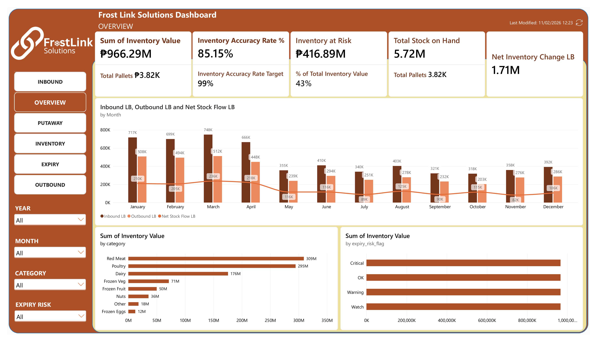
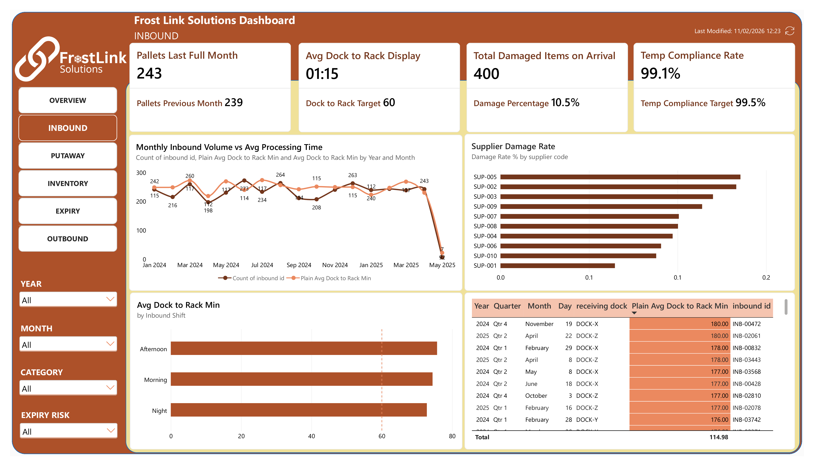
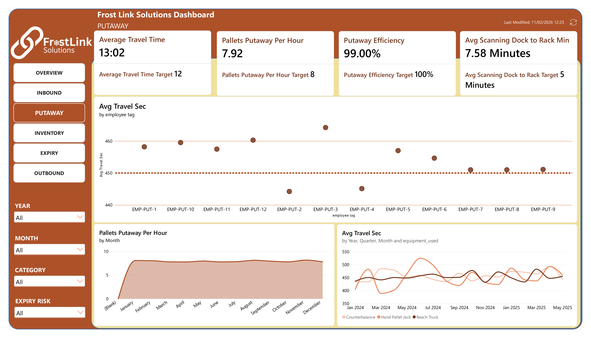
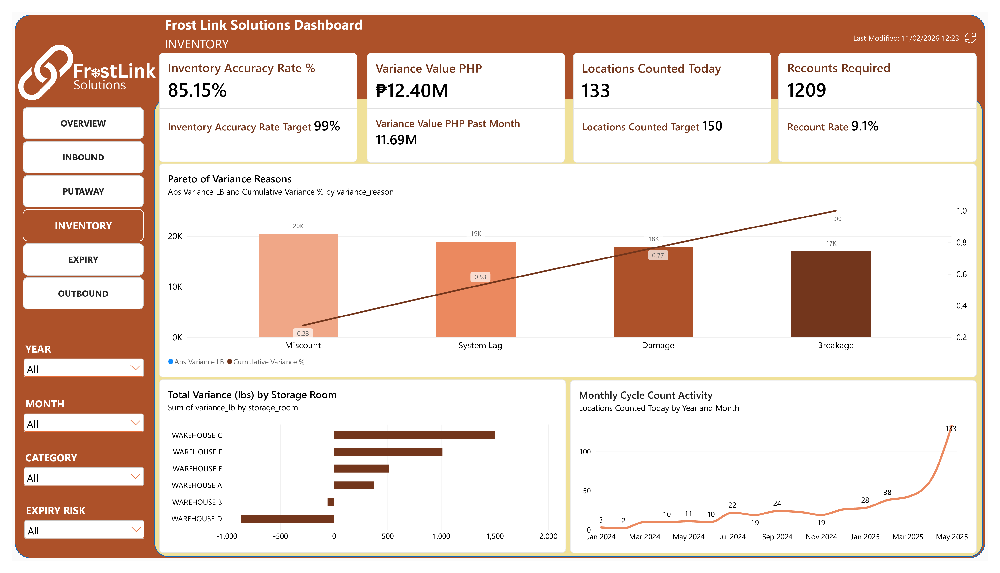
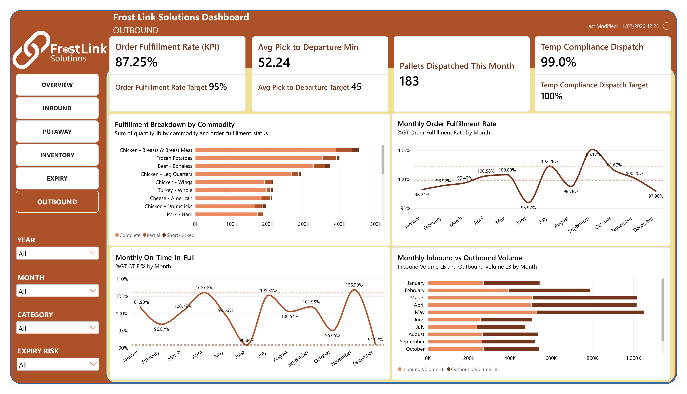
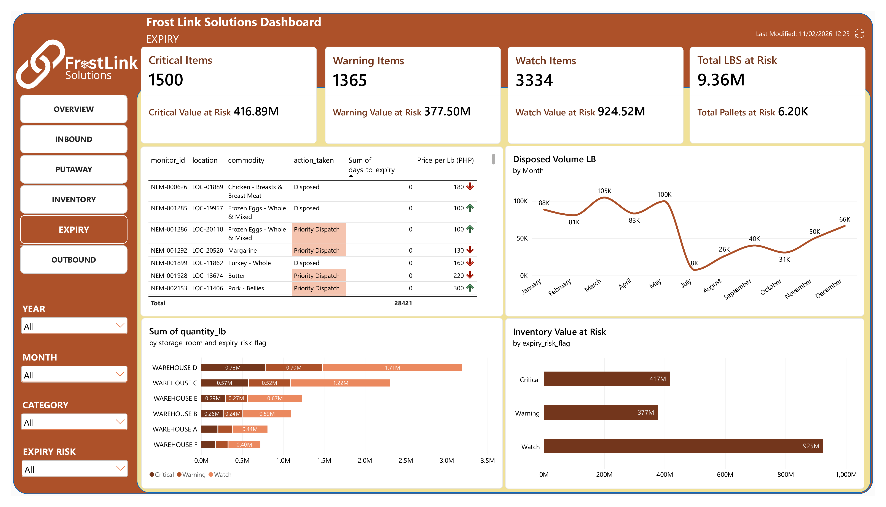

# FrostLink-Solutions-Supply-Chain-Dashboard
A six-page Power BI dashboard that follows a pallet through a cold storage facility, from the receiving dock to the outbound truck, and measures speed, accuracy, and product value at every step.

## Table of Contents
1. [Project Summary](#project-summary)
2. [Results at a Glance](#results-at-a-glance)
3. [Findings by Page](#findings-by-page)
4. [Cross-Page Takeaways](#cross-page-takeaways)
5. [Suggested Actions](#suggested-actions)
6. [Data Model](#data-model)
7. [Key DAX Measures](#key-dax-measures)
8. [SQL Layer](#sql-layer)
9. [Repository Structure](#repository-structure)
10. [Data Notes and Limitations](#data-notes-and-limitations)
11. [Author](#author)

---

## Project Summary

**Business question:** Where does a cold storage operation lose time, accuracy, and product value between the receiving dock and the outbound truck, and how much stock is at expiry risk while that happens?

**Scope:** 3,815 pallets, 6 storage rooms, 23 commodities across 8 categories, 10 suppliers, and 15 customers, covering January 2024 to May 2025.

**Approach:** Six operational datasets were modeled in PostgreSQL (Supabase) and loaded into Power BI. Each dashboard page answers one operational question and compares its KPIs against a fixed target.

| Page | Question it answers |
|---|---|
| Overview | What is the state of stock, value, flow, and risk? |
| Inbound | How fast and how cleanly is product received? |
| Putaway | How efficiently is product moved from the dock to the rack? |
| Inventory | How accurate is the system count, and what causes variance? |
| Outbound | Are orders picked complete and dispatched on time? |
| Expiry | Which stock is near or past expiry, and what is it worth? |

Every page shares the same five filters: **Year, Month, Storage Room, Category, Commodity**.

---

## Results at a Glance

| KPI | Result | Target | Status |
|---|---|---|---|
| Inventory accuracy (cycle counts) | 85.15% | 99% | Below target |
| Avg dock-to-rack time | 74.8 min | 60 min | Below target |
| Pallets putaway per hour | 7.92 | 8 | Near target |
| Avg scan dock-to-rack time | 7.6 min | 5 min | Below target |
| Inbound temperature compliance | 99.08% | 99.54% | Below target |
| Order fulfillment rate | 87.25% | 95% | Below target |
| Avg pick-to-departure time | 52.2 min | 45 min | Below target |
| Dispatch temperature compliance | 98.99% | 100% | Below target |
| On-time-in-full (OTIF) | 57.70% | none set | n/a |
| Stock value at expiry risk (latest snapshot) | ₱58.28M of ₱178.75M | none set | 32.6% of tracked value |

---

## Findings by Page

### 1. Overview
*What is the state of stock, value, flow, and risk?*



**Findings**

1. **Inventory value is concentrated in three categories.** Red Meat (₱309.2M, 32.0%), Poultry (₱294.6M, 30.5%), and Dairy (₱175.6M, 18.2%) hold 80.7% of the ₱966.3M inventory value. The other five categories share the remaining 19.3%. Any loss in these three categories moves the total much more than a loss anywhere else.
2. **A single commodity stands out.** Beef – Boneless alone is 18.8% of inventory value, and the top five commodities together are 51.2%. This makes beef the first place to look for risk.
3. **Stock has been building.** 5.73M lb was received and 4.02M lb was dispatched, a net gain of 1.71M lb. Net flow was positive in every month with complete data (January 2024 to April 2025). The monthly surplus narrowed from +309K lb in January 2024 (when outbound was still ramping up) to +45K lb in October 2024, then settled at +92K to +134K lb. A steady surplus means the facility is filling faster than it empties.
4. **Count accuracy is the weakest headline KPI.** At 85.15% against a 99% target, about 1 in 7 cycle counts finds a discrepancy. The Inventory page breaks down why.
5. **A third of tracked value is at risk.** In the latest expiry snapshot (May 26, 2025), ₱58.28M of ₱178.75M (32.6%) sat in Watch, Warning, or Critical status.
6. **The May 2025 net-flow bar is a data cut-off, not a real drop.** The inbound data ends on May 1, 2025, so May shows 8,300 lb in against 257,531 lb out. Read the trend through April 2025.

---

### 2. Inbound
*How fast and how cleanly is product received?*



**Findings**

1. **Receiving is slower than target and the delay is systemic.** Average dock-to-rack time is 74.8 min against a 60-min target. 65.6% of pallets exceed the target, the median is 75 min, and the slowest 10% take 111 min or more. The median sits above the target, so the problem is the normal process, not a few outliers.
2. **Dock and shift make almost no difference.** Docks X, Y, and Z average 74.4 to 75.5 min. Morning, afternoon, and night shifts average 74.4, 75.7, and 72.8 min. Because every dock and shift performs about the same, the cause is likely in the shared process (for example, how putaway is assigned), not in one team or location. The night shift handles only 105 pallets (2.8%), so its figure is less reliable.
3. **Trucks wait before unloading, too.** Truck arrival to dock clearance averages 40.2 min, so the full arrival-to-rack time is about 115 min.
4. **One in ten pallets arrives damaged or partial.** Of 3,815 inbound pallets, 191 were Damaged and 209 were Partial, a 10.5% rate.
5. **Supplier quality varies by a factor of two.** Damage rates range from 6.5% (SUP-001) to 13.6% (SUP-005), with SUP-002 close behind at 13.3%. Frozen Fruit has the highest category rate at 14.0%. Supplier-specific follow-up is more effective than a blanket receiving policy.
6. **Temperature compliance is high but short of target.** 99.08% of pallets arrived within range, against a 99.54% target. All 35 out-of-range pallets are in the "Other" category, which mixes commodities with different temperature needs and may be judged against the wrong band.
7. **Volume is steady.** Receiving runs at about 200 to 270 pallets a month, with no sign of a spike that would explain the slow dock-to-rack time. (May 2025 shows only 7 pallets because the data stops on May 1.)

---

### 3. Putaway
*How efficiently is product moved from the dock to the rack?*



**Findings**

1. **Putaway speed is close to target.** The rate is 7.92 pallets per hour against a target of 8, an efficiency of 99%. This rate is calculated from average travel time (3,600 seconds divided by average seconds per pallet), so it is a capacity figure, not a measured hourly count.
2. **Travel time is well inside its limit.** The average move takes 7.6 min (455 seconds), and 77.4% of moves finish within 10 min. The slowest 10% take about 11 min, and no move exceeds 12 min.
3. **Scan-to-scan time misses its 5-min target.** The average time between the dock scan and the rack scan is 7.6 min.
4. **Operators perform alike.** The 12 putaway operators average between 444 s (EMP-PUT-2) and 464 s (EMP-PUT-3), a spread of 4.5%. There is no operator who needs coaching and no one to hold up as the standard.
5. **Equipment type does not change speed.** Reach trucks (453 s, 2,113 moves), hand pallet jacks (454 s, 367 moves), and counterbalance trucks (457 s, 1,335 moves) are within 1% of each other. Reach trucks do 55% of the work.
6. **The night shift is the slowest.** It averages 485 s, 7% slower than the morning shift (453 s), though on a small sample.
7. **The physical move is not the bottleneck.** Putaway travel averages 7.6 min, while the full dock-to-rack time on the Inbound page is 74.8 min. Time spent moving is a small part of the total, so reducing waiting before and between steps will help more than faster driving. These two figures come from different timestamp sources, so confirm the split with scan-level data before acting on it.

---

### 4. Inventory
*How accurate is the system count, and what causes variance?*



**Findings**

1. **About 1 in 7 counts finds a discrepancy.** Of 13,303 cycle counts, 14.85% had a recorded variance reason. 9.09% (1,209 counts) required a recount.
2. **The causes are evenly spread.** Miscount (27.5% of absolute variance), System Lag (25.5%), Damage (24.1%), and Breakage (22.9%) are nearly equal. The Pareto curve is almost a straight line, so fixing one cause will not close the gap. Miscount and System Lag are process and system issues, while Damage and Breakage are handling issues. Each needs a different fix.
3. **Net variance hides the real error.** Gains (+38,307 lb) and losses (−35,818 lb) almost cancel, leaving a net of +2,489 lb. The absolute error is 74,125 lb, worth ₱12.40M. Looking only at the net would suggest the counts are nearly perfect.
4. **Three rooms carry most of the variance.** Warehouse D accounts for 27.4% of absolute variance, C for 22.2%, and E for 18.3%, together 68%. Warehouses A and B are about 7% each. The same three rooms hold the most stock, so part of this reflects volume.
5. **The recount rule catches real errors.** Recounted locations average a 3.5% variance, against 0.06% for locations that passed the first count.
6. **Variance value is rising, but accuracy is not falling.** Monthly variance value grew from ₱0.86M (February 2025) to ₱2.76M (May 2025), yet monthly accuracy stayed between 84% and 86%. The cause is count volume, which rose from 866 counts in December 2024 to 2,715 in May 2025. More counting finds more variance in absolute terms without making the rate worse.
7. **Count coverage reached its target only recently.** On the latest date 133 locations were counted against a target of 150. Over the full period the daily average is about 26.

---

### 5. Outbound
*Are orders picked complete and dispatched on time?*



**Findings**

1. **Fulfillment has never reached its target.** The order fulfillment rate is 87.25% against 95%. The best month was 91.8% (September 2024) and the worst 83.7% (June 2024), so no month came close to 95%. Of 2,683 dispatched pallets, 242 were Partial and 100 were Short-picked.
2. **Timing, not stock, is the main failure.** 87.25% of orders are complete, but only 57.70% are both complete and on time. The monthly OTIF rate stayed between 52% and 64%.
3. **Slow pick-to-departure explains the lateness.** The average is 52.2 min against a 45-min target, and 62.5% of dispatches exceed it. The model counts a dispatch as on time when the truck leaves within 60 min of pick completion, so 34.4% of dispatches (922 pallets) are late, and every late dispatch took 61 to 80 min. Cutting the wait between a finished pick and truck departure would lift on-time performance more than any other step. (The 45-min figure is the target for the average; the 60-min figure is the on-time rule. They are different thresholds.)
4. **Picking itself is only part of the delay.** Picking takes about 37 min on average, and a further 52 min passes between pick completion and truck departure. Picked pallets are waiting for trucks.
5. **One commodity is a clear weak spot.** Frozen Eggs – Whole & Mixed completes only 72.7% of orders, about 15 points below the average. Frozen Eggs is the weakest category overall, followed by Other (84.0%) and Nuts (84.1%).
6. **Docks, customers, and pickers are consistent.** Docks V and W both fulfil about 87% and average 52 min. Customer on-time rates cluster around 61% to 66%. Picker averages range from 49.7 to 54.0 min. There is no single customer, dock, or person to blame.
7. **Dispatch temperature compliance is 98.99% against a 100% target.** All 27 out-of-range pallets are in the "Other" category, the same category behind the inbound temperature misses.

---

### 6. Expiry
*Which stock is near or past expiry, and what is it worth?*



*Findings use the latest weekly snapshot (May 26, 2025), because the data holds 59 snapshots and summing them would count each pallet about 11 times. Figures are as recorded in the monitoring table, which is what the dashboard shows, except finding 2, which reconciles them with dispatch records.*

**Findings**

1. **A third of tracked value is at risk.** 215 of 679 pallets (31.7%) are flagged Watch, Warning, or Critical, worth ₱58.28M of ₱178.75M (32.6%).
2. **Most of that stock has already left the building.** 513 of the 679 pallets in the latest snapshot (75.6%) have a dispatch record dated on or before the snapshot date, and across all snapshots the share is 75.3%. Excluding them leaves 166 pallets worth ₱42.35M, of which 60 pallets worth ₱15.22M (35.9%) are at risk: 19 Critical (₱5.59M), 11 Warning (₱2.31M), and 30 Watch (₱7.32M). The monitoring table and the dispatch table disagree on which pallets are still in stock, and the true exposure depends on which one is correct. The reconciled figures are the conservative ones to rely on.
3. **The warning bands are short.** Critical means 0 to 7 days to expiry, Warning 8 to 14 days, and Watch 15 to 30 days. The 62 Critical pallets (₱17.83M, 95,575 lb) have about a week left. Warning adds 36 pallets (₱8.33M) and Watch 117 pallets (₱32.13M).
4. **Risk follows value.** Red Meat (₱20.35M, 35% of at-risk value) and Poultry (₱18.60M, 32%) lead. Beef – Boneless alone is ₱11.68M, 20%.
5. **Warehouse D is the hotspot.** It holds ₱21.26M (36.5%) of at-risk value, nearly double the next room, C (₱10.93M). Warehouse F is lowest at ₱3.38M.
6. **Action is mostly taken, but not always.** Across all snapshots, 1,500 Critical records resulted in 774 Priority Dispatch (51.6%), 445 Disposed (29.7%), and 281 with no action (18.7%). In the latest snapshot, 11 of the 62 Critical pallets still had no action recorded.
7. **Warning stock is mostly pushed out early.** Of 1,365 Warning records, 844 (61.8%) went to Priority Dispatch, which is the cheapest outcome. Moving more Watch stock earlier could reduce the volume that reaches Critical.
8. **Disposal is growing.** Disposed volume rose from about 7,600 lb in July 2024 to about 99,700 lb in May 2025, and 678,062 lb was disposed in total. This may reflect more risk, closer monitoring, or both.

---

## Cross-Page Takeaways

1. **Time is lost to waiting, not to work.** Putaway moves take about 7.6 min, but dock-to-rack takes 74.8 min. Picking takes about 37 min, but the pallet then waits 52 min for departure. In both cases the physical task is fast and the queue around it is slow.
2. **Performance is uniform across docks, shifts, people, and equipment.** No dock, shift, operator, or machine stands out. This points to process and scheduling design as the source of delay, not to individual performance.
3. **Accuracy and risk share a common cause.** Variance is spread across four causes and is highest in Warehouses D, C, and E, the same rooms that carry the most value and the most expiry risk. These rooms are the priority for count discipline and stock rotation.
4. **The "Other" category is a recurring problem.** It causes every temperature miss, inbound and outbound, and sits among the weakest fulfillment categories. It likely groups commodities with different requirements.

---

## Suggested Actions

| Priority | Action | Targets finding |
|---|---|---|
| 1 | Review the wait between dock clearance and putaway start, and between pick completion and truck departure (dispatch scheduling, staging, putaway assignment) | Inbound 1–3, Putaway 7, Outbound 3–4 |
| 2 | Clear Critical pallets within the 7-day window; require a recorded action on every Critical flag | Expiry 2, 5 |
| 3 | Target count effort at Warehouses D, C, and E, and address System Lag with a scan-to-system sync check | Inventory 2, 4 |
| 4 | Run supplier reviews for SUP-005 and SUP-002 (13%+ damage rates) | Inbound 5 |
| 5 | Split the "Other" category by commodity and set a temperature band for each | Inbound 6, Outbound 7 |
| 6 | Investigate Frozen Eggs – Whole & Mixed fulfillment (72.7%) | Outbound 5 |
| 7 | Reconcile the expiry monitoring table with dispatch records so shipped pallets drop out of at-risk stock | Expiry 2 |

---

## Data Model

Six tables describe one facility. The pallet master is the reference; the other five record events.

| Table | Rows | Content |
|---|---|---|
| `00_pallet` | 3,815 | Pallet master: commodity, category, room, quantity, price, value |
| `01_inbound` | 3,815 | Receipts: arrival, clearance and putaway times, temperature, condition |
| `02_putaway` | 3,815 | Dock-to-rack moves: operator, equipment, scan times, travel seconds |
| `03_dcc` | 13,303 | Daily cycle counts: system vs physical quantity, variance reason |
| `04_expiry` | 21,200 | Weekly expiry snapshots (59), risk flag, action taken |
| `05_outbound` | 2,683 | Dispatches: pick and departure times, temperature, fulfillment status |

Cycle counts, expiry snapshots, and outbound events agree fully with the pallet master (same commodity, room, quantity, and expiry date). Inbound and putaway do not: they are self-contained event logs, so their results are reported on their own columns and are not joined to the pallet master or to each other. See [Data Notes and Limitations](#data-notes-and-limitations).

---

## Key DAX Measures

```dax
-- Share of cycle counts with no variance reason
Inventory Accuracy Rate % =
DIVIDE(
    COUNTROWS('03_dcc')
        - COUNTROWS(FILTER('03_dcc', '03_dcc'[variance_reason] <> "None")),
    COUNTROWS('03_dcc'),
    0
)

-- On-time-in-full: complete orders that also left on time
OTIF % =
DIVIDE(
    CALCULATE(
        COUNTROWS('05_outbound'),
        '05_outbound'[order_fulfillment_status] = "Complete",
        '05_outbound'[On Time] = 1
    ),
    COUNTROWS('05_outbound')
)

-- Putaway rate implied by average travel time
Pallets Putaway Per Hour =
VAR AvgSecs = AVERAGE('02_putaway'[travel_time_seconds])
RETURN DIVIDE(3600, AvgSecs, 0)

-- Peso value of stock at Critical expiry risk
Critical Value at Risk =
SUMX(
    FILTER('04_expiry', '04_expiry'[expiry_risk_flag] = "Critical"),
    '04_expiry'[quantity_lb] * RELATED('00_pallet'[Price per Lb (PHP)])
)

-- Peso value of count variance
Variance Value PHP =
SUMX('03_dcc', ABS('03_dcc'[variance_lb]) * RELATED('00_pallet'[Price per Lb (PHP)]))

-- Net stock movement
Net Stock Flow LB = [Inbound LB] - [Outbound LB]
```

---

## SQL Layer

`sql/schema_and_queries.sql` rebuilds the analysis in PostgreSQL. It was written for Supabase and checked by loading the full dataset and running every statement; the results match the figures in this README.

| Part | What it contains |
|---|---|
| 1. Schema | Six tables with primary keys, foreign keys, check constraints, and indexes. Inventory value is a generated column (quantity × price per lb). |
| 2. Views | `v_inbound`, `v_putaway`, `v_outbound`, `v_dcc`, `v_expiry`: the calculated columns used in Power BI (dock-to-rack minutes, on-time flag, temperature compliance, variance value, peso value of expiry stock, already-dispatched flag). |
| 3. Analytical queries | 28 queries grouped by dashboard page. Each one maps to a finding above. |
| 4. Data-quality checks | Six checks that test the links between tables and flag the issues listed under Data Notes. |

| Page | Queries |
|---|---|
| Overview | Q1–Q4: totals, value by category, top commodities, monthly flow |
| Inbound | Q5–Q8: dock-to-rack, dock and shift, supplier damage, temperature |
| Putaway | Q9–Q11: travel time, pallets per hour, equipment, operators |
| Inventory | Q12–Q16: accuracy, Pareto of causes, net vs absolute variance, monthly trend |
| Outbound | Q17–Q22: fulfillment, OTIF, pick-to-departure, categories, temperature |
| Expiry | Q23–Q28: risk by flag, room, and category; actions; reconciled snapshot |

**To run it:** create a Supabase project (or any PostgreSQL database), run section 1 and 2 in the SQL editor, load the six CSVs in this order: pallet, inbound, putaway, cycle_count, expiry_monitor, outbound, then run the queries one at a time.

---

## Repository Structure

```
frostlink-cold-storage-dashboard/
├── data/
│   ├── 00_pallet.csv
│   ├── 01_inbound.csv
│   ├── 02_putaway.csv
│   ├── 03_dcc.csv
│   ├── 04_expiry.csv
│   ├── 05_outbound.csv
│   └── data_dictionary.md
├── sql/
│   └── schema_and_queries.sql
├── screenshots/
│   ├── overview.png
│   ├── inbound.png
│   ├── putaway.png
│   ├── inventory.png
│   ├── outbound.png
│   └── expiry.png
├── dashboard/
│   └── FrostLink_Dashboard.pbix
└── README.md
```

---

## Data Notes and Limitations

- **The data is synthetic.** It was generated to mirror real cold storage warehouse management system records and anchored to USDA reference data. It contains no real company, client, or personal information. Because it is generated, operator, equipment, dock, and shift results are more uniform than they would be in real operations.
- **Expiry snapshots repeat.** The expiry table holds 59 weekly snapshots, about 11 per pallet. Expiry figures here use the latest snapshot. Summing across snapshots overstates stock at risk.
- **May 2025 inbound is incomplete.** Inbound records end on May 1, 2025, so May inbound volume and net flow should be ignored.
- **Fixed targets.** KPI targets (for example 60 min dock-to-rack, 95% fulfillment, 99% accuracy) are set values in the model, not derived from the data.
- **Putaway rate is derived.** Pallets per hour is calculated from average travel time, not counted from hourly throughput.
- **Inbound and putaway do not link to the rest of the data.** Inbound rows do not match their pallet master record (quantity never matches, storage room matches for about half, and 1,888 pallets are received before their manufacture date). Putaway rows do not match the inbound row they point to (none share a pallet ID). Inbound and putaway findings therefore use only their own columns.
- **Dispatch dates conflict with other tables.** 1,191 of 2,683 pallets are dispatched before their inbound receipt date, and the expiry table keeps tracking pallets after they were dispatched (see the Expiry page).
- **Mixed timestamp sources.** Inbound times and putaway scan times come from different tables and are not directly comparable.
- **Two time thresholds in Outbound.** The model treats up to 60 min from pick completion to departure as on time. The 45-min value is a separate target for the average.

---

## Author

**Dustine**
Process Engineer · Industrial Engineer
[LinkedIn](#) · [GitHub](#)
